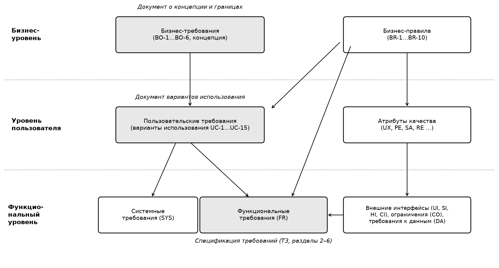
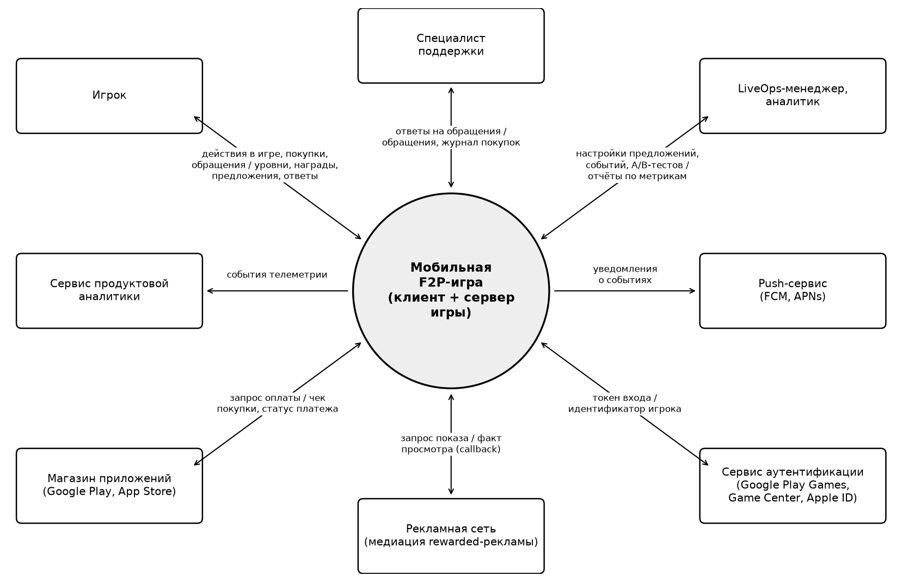
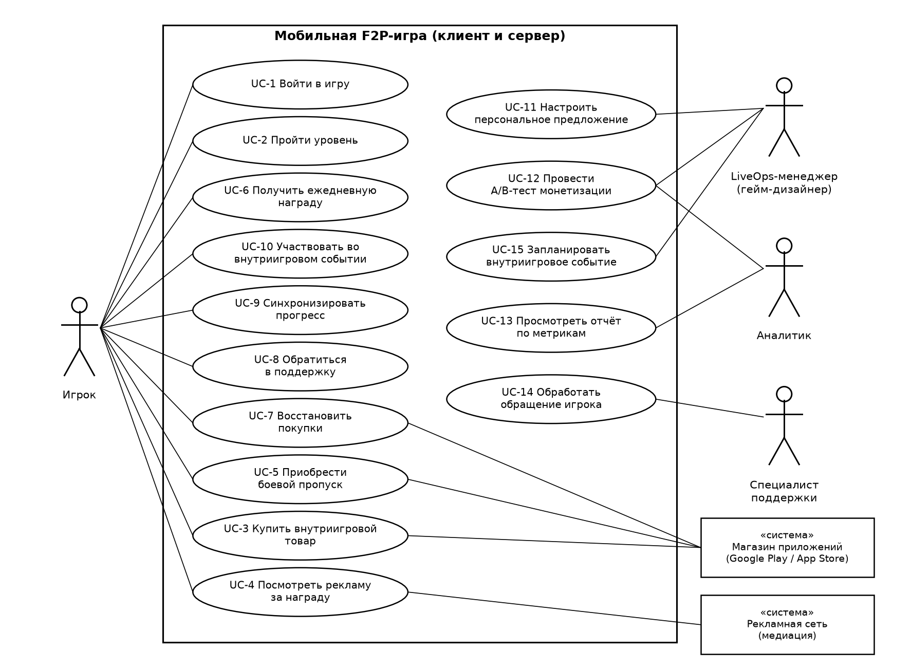
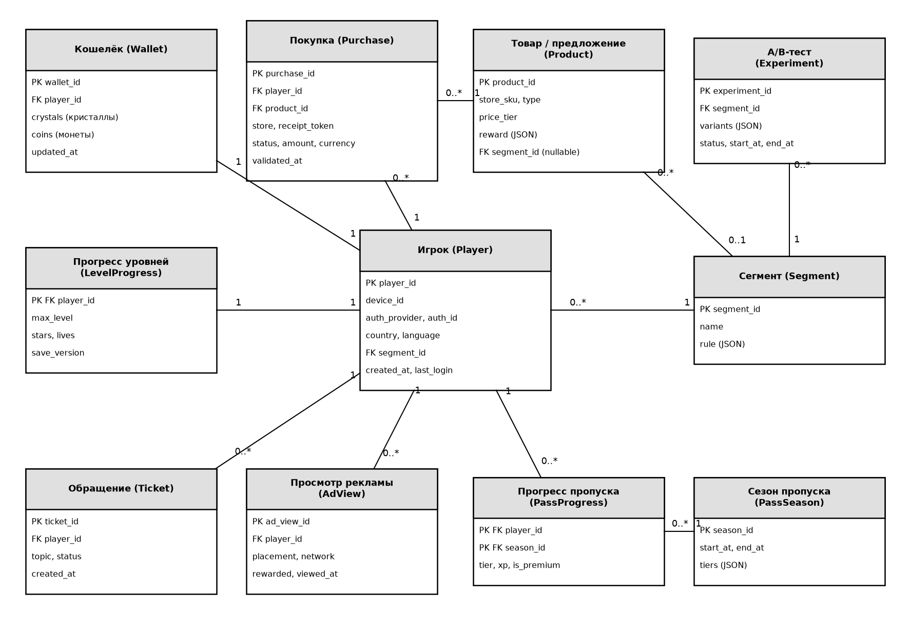

# Лабораторная работа №4 — Анализ требований и разработка спецификации требований к программному средству

Дисциплина «Разработка требований к программному обеспечению», ПГУ, ФИТ, кафедра ВМСиС.
Выполнил: И. А. Прудников, гр. 25-СТ, вариант 10.
Проект: мобильная free-to-play игра «Crystal Quest».

## Цель

Составить документ о концепции и границах (Vision & Scope) проекта, представить пользовательские требования вариантами использования и разработать спецификацию функциональных и нефункциональных требований (разделы 2–6 технического задания).

## Содержание

- Документ Vision & Scope: исходные данные, возможности бизнеса, шесть измеримых бизнес-целей, основные функции первой версии и профили заинтересованных лиц.
- Уровни требований по К. Вигерсу: бизнес-требования, пользовательские и функциональные требования, бизнес-правила, атрибуты качества, внешние интерфейсы и ограничения.
- Пользовательские требования: 15 вариантов использования (UC-1…UC-15) с диаграммой и описанием сценариев.
- Спецификация требований (SRS): внешние интерфейсы, 44 функциональных требования, требования к юзабилити, производительности и данным, логическая модель данных (ER-диаграмма) и каталог из 12 бизнес-правил.

## Файлы

- [РТКПО_ЛР4_Прудников И.А._вариант10.docx](<РТКПО_ЛР4_Прудников И.А._вариант10.docx>) — отчёт (DOCX)
- [РТКПО_ЛР4_Прудников И.А._вариант10.pdf](<РТКПО_ЛР4_Прудников И.А._вариант10.pdf>) — отчёт (PDF)

## Рисунки

Рисунок 1 — модель требований к мобильной F2P-игре по классификации К. Вигерса.

Рисунок 2 — контекстная диаграмма системы (границы проекта).

Рисунок 3 — диаграмма вариантов использования мобильной F2P-игры.

Рисунок 4 — логическая модель данных (ER-диаграмма).

