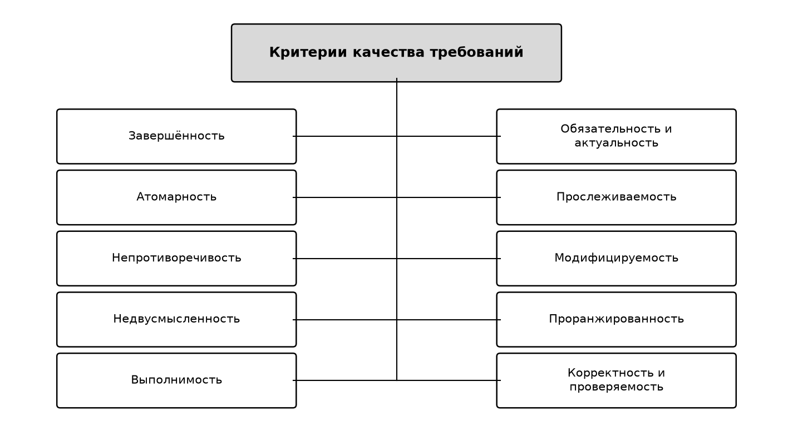
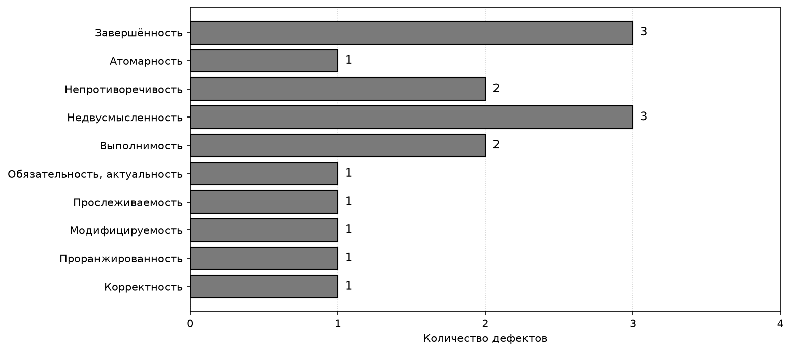

# Лабораторная работа №5 — Тестирование требований

Дисциплина «Разработка требований к программному обеспечению», ПГУ, ФИТ, кафедра ВМСиС.
Выполнил: И. А. Прудников, гр. 25-СТ, вариант 10.
Проект: мобильная free-to-play игра «Crystal Quest».

## Цель

Изучить критерии качества требований и протестировать спецификацию требований к программному обеспечению, разработанную в лабораторной работе №4.

## Содержание

- Технический просмотр SRS из ЛР4: документ о концепции и границах, варианты использования UC-1…UC-15 и разделы 2–6 технического задания (44 функциональных требования и 12 бизнес-правил).
- Чек-лист по критериям качества требований и журнал из 16 обнаруженных дефектов с указанием нарушенного критерия.
- Уточняющие вопросы к заказчику и исправленные формулировки требований.
- Тест-кейсы для исправленных требований и матрица прослеживаемости (бизнес-цель — вариант использования — функциональное требование — тест-кейс).

## Файлы

- [РТКПО_ЛР5_Прудников И.А._вариант10.docx](<РТКПО_ЛР5_Прудников И.А._вариант10.docx>) — отчёт (DOCX)
- [РТКПО_ЛР5_Прудников И.А._вариант10.pdf](<РТКПО_ЛР5_Прудников И.А._вариант10.pdf>) — отчёт (PDF)

## Рисунки

Рисунок 1 — критерии качества требований.

Рисунок 2 — распределение 16 дефектов по нарушенным критериям качества.

