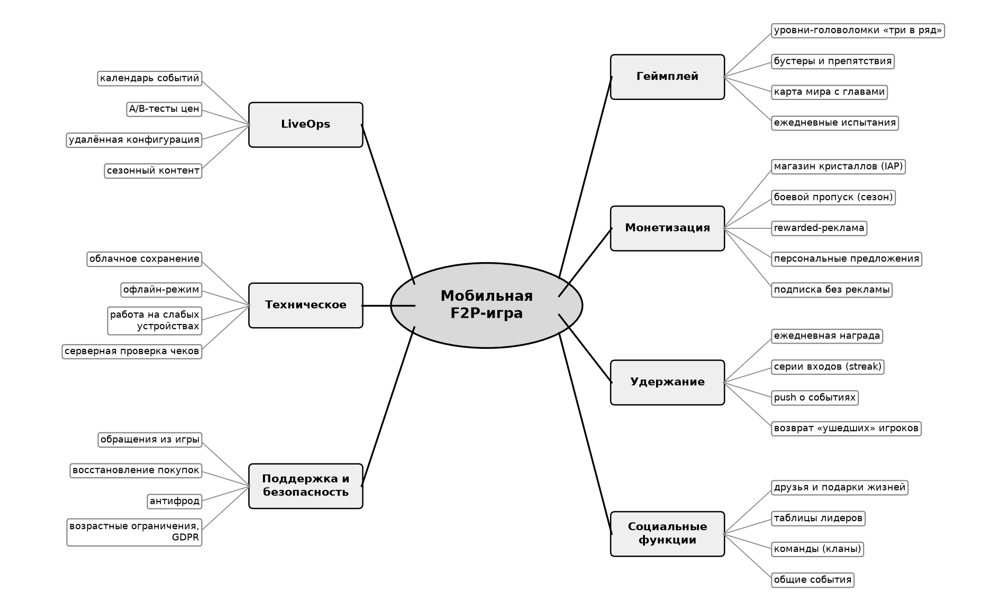
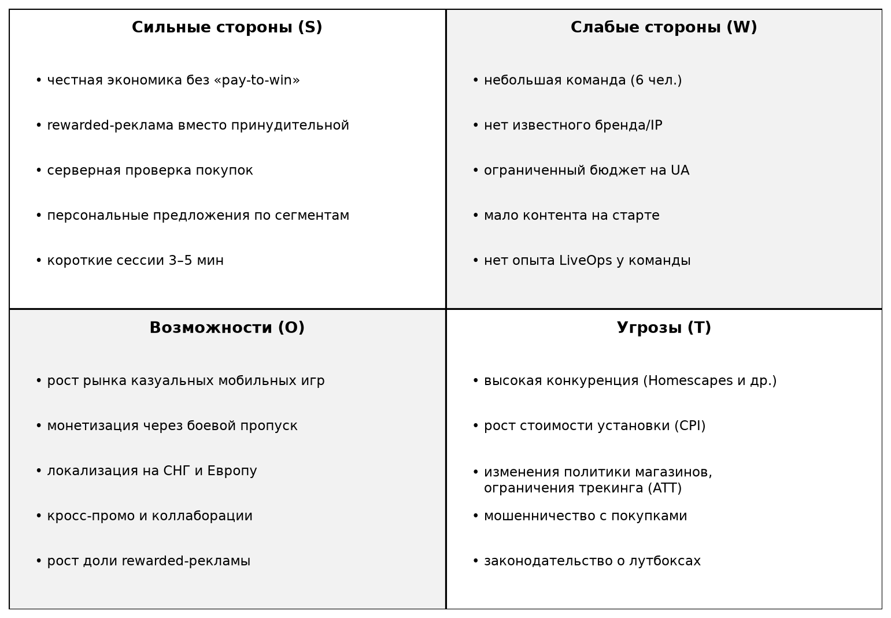
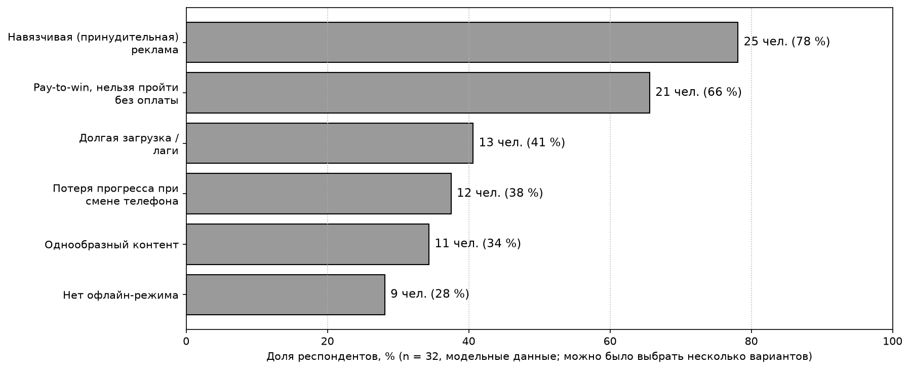

# Лабораторная работа №6 — Разработка требований к программному обеспечению

Дисциплина «Разработка требований к программному обеспечению», ПГУ, ФИТ, кафедра ВМСиС.
Выполнил: И. А. Прудников, гр. 25-СТ, вариант 10.
Проект: мобильная free-to-play игра «Crystal Quest».

## Цель

Научиться формулировать и документировать требования к ПО: собрать их методами анализа аналогов, мозгового штурма и анкетирования и оформить документ требований по стандарту IEEE 830.

## Содержание

- Анализ игр-конкурентов жанра «три в ряд»: Candy Crush Saga, Royal Match, Homescapes и Toon Blast.
- Мозговой штурм (35 идей), структурированный интеллект-картой, и SWOT-анализ проекта.
- Модельный опрос игроков (n = 32): главные раздражители — принудительная реклама и pay-to-win.
- Документ требований по IEEE 830: 20 функциональных и 14 нефункциональных требований с приоритетами MoSCoW, а также требования к интерфейсам.

## Файлы

- [РТКПО_ЛР6_Прудников И.А._вариант10.docx](<РТКПО_ЛР6_Прудников И.А._вариант10.docx>) — отчёт (DOCX)
- [РТКПО_ЛР6_Прудников И.А._вариант10.pdf](<РТКПО_ЛР6_Прудников И.А._вариант10.pdf>) — отчёт (PDF)

## Рисунки

Рисунок 1 — интеллект-карта идей мозгового штурма.

Рисунок 2 — SWOT-анализ проекта мобильной F2P-игры.

Рисунок 3 — что раздражает игроков в бесплатных играх (модельные данные, n = 32).

